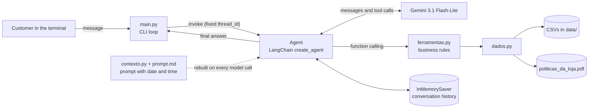

# Empório da Música: customer service agent

[🇧🇷 Português](README.md) · 🇺🇸 English


This is a prototype of a text-message customer service agent for Empório da Música, a fictional musical instrument store in Campo Grande, MS (Brazil). I built it for Artefact's AI Engineer technical challenge.

The agent runs in the terminal and talks in Brazilian Portuguese in the store's tone. It answers from two sources: the operational CSVs (catalog, promotions, customers and orders) and the policy manual in PDF. The approach is **function calling**. The model decides which query to make, and the Python code runs the query, applies the business rules and hands the already-computed data back to the model to write the reply.

```text
Você: Quanto custa o Takamine GD20?
  [consultou: buscar_produtos]
Empório da Música: O Takamine GD20 Dreadnought Natural custa R$ 2.199,00, ou R$ 2.089,05 no PIX. A gente parcela em até 12x de R$ 183,25 sem juros.
```
<sub>Verbatim excerpt from [`exemplos/03_preco_e_promocao_expirada.md`](exemplos/03_preco_e_promocao_expirada.md). The customer asks how much the guitar costs; the agent gives the list price, the PIX price and the interest-free installments. All three values were computed by the code, not by the model. The `[consultou: ...]` line ("queried: ...") is printed by the CLI and shows which tools the agent called in that turn.</sub>

| | |
|---|---|
| **Language** | Python (developed with 3.14) |
| **Approach** | Function-calling agent with 5 tools |
| **Framework** | LangChain `create_agent`, with a LangGraph checkpointer |
| **Model** | Gemini 3.1 Flash-Lite (`gemini-3.1-flash-lite`), via the Google AI Studio API |
| **Interface** | CLI |
| **History** | In memory, while the program is open |

## Table of contents

- [Overview](#overview)
- [How to run](#how-to-run)
- [How the project meets the challenge](#how-the-project-meets-the-challenge)
- [Architecture](#architecture)
- [Technical decisions](#technical-decisions)
- [Data and inconsistencies](#data-and-inconsistencies)
- [Example conversations](#example-conversations)
- [Known limitations](#known-limitations)
- [Next steps](#next-steps)
- [Use of code assistants](#use-of-code-assistants)
- [License](#license)

## Overview

**The problem.** The store's staff is overloaded with repetitive questions about price, stock, order status, returns and opening hours. The answers are spread across six CSVs and an 8-page manual, and these sources contradict each other in several places.

**The approach.** The model decides *what to look up* and writes the reply. Everything else lives in code: filtering, joining tables, computing prices and installments, identifying the customer and counting days for return deadlines. The idea is that the most costly mistakes in customer service (a wrong price, a wrong deadline, exposed personal data) depend on code I can read and test, not on the model's arithmetic or memory.

**The decisions the project rests on:**

- **Function calling instead of RAG for the data.** Catalog and order questions are filters and exact lookups, and semantic search guarantees neither.
- **The manual is read by whole section, with no vector search.** With 8 pages and 10 sections, chunking would risk splitting a rule or a table with no gain in precision.
- **Privacy in order lookups.** Orders are only looked up with the phone or e-mail on file. Any failure returns the same message, and the model only receives the customer's first name.
- **No invented actions.** The agent does not cancel, exchange or register anything, and the prompt stops it from saying it did.
- **Inconsistencies documented, not silently fixed.** There are 34 items in [`INCONSISTENCIAS.md`](INCONSISTENCIAS.md) (in Portuguese), each with the assumption the agent adopts.

**Where to start reading:** [`ferramentas.py`](ferramentas.py) (business rules and tools), [`prompt.md`](prompt.md) (persona and service rules) and the example [`04_devolucao_com_pedido_real.md`](exemplos/04_devolucao_com_pedido_real.md), which combines order data and policies.

## How to run

### Prerequisites

- Python 3.10 or higher. I developed and tested the project with Python 3.14.7.
- A Gemini API key, which can be generated at [Google AI Studio](https://aistudio.google.com/).

### Installation

```bash
git clone https://github.com/tiagomafratm22-source/music-store-agent.git
cd music-store-agent

python -m venv .venv
# Windows (PowerShell)
.venv\Scripts\Activate.ps1
# Linux/macOS
source .venv/bin/activate

pip install -r requirements.txt
```

The versions in `requirements.txt` are pinned to the ones from the environment I developed the project in.

### Configuration

Copy `.env.example` to `.env` and fill in the key:

```bash
# Windows
copy .env.example .env
# Linux/macOS
cp .env.example .env
```

```dotenv
GOOGLE_API_KEY=your_key_here
LLM_MODEL=gemini-3.1-flash-lite
```

| Variable | Required | Description |
|---|---|---|
| `GOOGLE_API_KEY` | Yes | Gemini API key. Without it, the program warns and exits. |
| `LLM_MODEL` | No | Model used by the agent. Default: `gemini-3.1-flash-lite`. |

`.env` is listed in `.gitignore`, so the key is not versioned.

### Running

```bash
python main.py
```

Type messages as a customer. To quit, type `sair`, `exit` or `quit`, or press `Ctrl+C`. After each answer that involved lookups, the CLI shows the `[consultou: ...]` line with the tools called in that turn.

## How the project meets the challenge

| Challenge requirement | How the project meets it |
|---|---|
| Persona aligned with the store | The prompt defines an informal, direct attendant who says "a gente" and "aqui na loja" (colloquial Brazilian for "we" and "here at the store"), avoids telemarketing phrases and writes plain text without markdown, like a WhatsApp chat. The tone follows §7.1 of the manual ("informal but professional"). |
| Answer based on context | Product, price, promotion, order and policy are never answered from memory. The prompt requires a lookup before answering. When the lookup does not return the data, the agent says it could not confirm it and gives the store's contacts. |
| Know when to query data and when to query policies | Each source has its own tool, and each tool's docstring describes what it covers. The model picks the tool from those descriptions. |
| Handle out-of-scope questions | Topics unrelated to the store are declined in one sentence. Requests for accessories are told that the store only sells instruments (§1 and §7.1 of the manual). |

In addition, the agent:

- looks up orders only after the customer gives the phone or e-mail on file;
- applies the withdrawal, defect exchange and statutory warranty deadlines to the dates of the order found;
- says when a product is out of stock, discontinued or not yet released, and suggests available alternatives (§7.3), with the caveat described in [Known limitations](#known-limitations);
- says when a promotion mentioned by the customer is not active, and does not promise the discount (§7.3);
- knows the current date and time in Campo Grande and whether the store is open, to tell when human support is back.

## Architecture

### Project structure

```text
.
├── main.py              # CLI loop, model and agent creation
├── contexto.py          # Builds the system prompt with date, time and store status
├── prompt.md            # System prompt text: persona and service rules
├── ferramentas.py       # Tools exposed to the model and business rules
├── dados.py             # CSV reading and splitting of the manual into sections
├── data/                # Operational CSVs and policy manual provided by the store
├── exemplos/            # Five conversations recorded from the CLI
├── INCONSISTENCIAS.md   # Problems found in the data and how the agent handles each
├── requirements.txt
└── .env.example
```

### Components



### Flow of one turn

1. `main.py` reads the message and calls the agent with a fixed `thread_id`, which identifies the conversation in the checkpointer.
2. Before each model call, the `dynamic_prompt` middleware rebuilds the system prompt with the date, time and store status (open or closed) in Campo Grande's time zone.
3. The model either answers directly or requests one or more tools. The agent runs the tools and returns the result to the model, repeating the cycle until there is a final answer.
4. The checkpointer stores the whole conversation, including query results, so the model can reuse data brought in earlier turns.
5. The CLI strips any markdown the model may have used and prints the answer.

### Tools

| Tool | Purpose | Source |
|---|---|---|
| `buscar_produtos(termo, preco_max, apenas_disponiveis)` | Price, stock, status, current promotion and installments of products. Returns alternatives when nothing found is available. | `products`, `categories`, `promotions` |
| `listar_promocoes_ativas()` | Lists products with an active promotion. | `promotions`, `products` |
| `simular_parcelamento(valor)` | Maximum interest-free installments and installment amount for any value, such as the sum of two products. | Rule from §3.1 |
| `consultar_pedidos(telefone_ou_email, numero_pedido)` | Orders of the identified customer: status, items, total, tracking, estimated delivery and elapsed days. | `customers`, `orders`, `order_items`, `products` |
| `consultar_politicas(secao)` | Full text of one section of the manual: contact and address, hours, payment, returns and exchanges, shipping, promotions, warranty or privacy. | `politicas_da_loja.pdf` |

## Technical decisions

### Function calling for structured data

The most common questions about the data are filters and exact lookups. "Guitars available up to R$ 1,000" depends on price, status and stock. "How is my order" depends on finding a specific record for a specific customer. Semantic search over CSVs handles neither case well: text similarity does not enforce a price ceiling, nor does it guarantee that the returned record is the right order. So each kind of query became a tool, and the code does the filtering and table joins.

### Business rules in code, not in the model

Final price with promotion, PIX price, maximum number of installments and installment amount are computed in `montar_ficha` and reach the model ready to use, with the instruction not to do any math. This solves two problems. Language models frequently make arithmetic mistakes, and the manual itself (§7.1) warns that incorrect information can amount to misleading advertising. Also, each rule lives in a single place in the code, instead of being repeated in the prompt and in the model's reasoning.

Rules implemented:

- **Installments (§3.1):** minimum installment of R$ 50 up to 3x, R$ 80 from 4x to 6x and R$ 100 from 7x to 12x.
- **PIX:** 5% discount on the list price, not combinable with a promotion (§3 and §6.2). For a product on promotion, `preco_no_pix` is empty.
- **Promotions:** the `is_active` field is the only indication of validity. If a product has two active promotions, the one with the larger discount applies.
- **Product status:** status takes precedence over stock. A discontinued product with stock is still discontinued, and only "available" can be purchased.
- **Alternatives (§7.3):** when no result is available, the search already returns up to three available products from the same category, ordered by price proximity.
- **Deadlines:** each order comes with `dias_desde_compra` (days since purchase) and `dias_desde_previsao_entrega` (days since estimated delivery), so the model compares deadlines without calculating dates.

### Manual read by section, no vector search

The manual has 8 pages and 10 numbered sections, with short rules and a few tables, such as the payment methods one. At this size, vector search would add embeddings and an index with no real gain in precision, plus the risk of a chunk cutting a rule or a table in half. The `consultar_politicas` tool always returns the whole section, and the model picks the section from the list described in the docstring.

Extraction details in `dados.py`:

- Text is extracted with pypdf's `extraction_mode="layout"`, which preserves lines and tables. In the default mode, the text came out one word per line.
- Headers and footers repeated on every page are removed.
- A section only starts at its exact title. Without this, the numbered list in §7.2 ("1. Saudação", "2. Entendimento"...) would be mistaken for section titles.
- If an expected section is not found, loading fails with an error instead of handing the model an incomplete manual.
- The result is cached after the first read (`functools.cache`).
- Sections 7 (WhatsApp service) and 10 (final provisions) are not available for lookup, because they guide the staff and not the customer. What matters from them for the agent was built into the prompt.

The cost of this choice is sending the model the whole section even when only one line matters, and depending on the exact titles in the PDF. For a manual this size, I consider both costs acceptable. The title dependency fails loudly on purpose: if the PDF changes, the program stops instead of answering with an incomplete policy.

### Lexical catalog search

The catalog has 65 products. At this size, I chose a word-based search tolerant of spelling variations, with no embeddings. How it works:

- **Normalization:** lowercase, accent-free, and the "-ões" plural folded into the singular ("Violões" becomes "violao"). Articles, prepositions and words like "reais" are ignored.
- **Partial matches and typos:** a term matches part of a word ("yama" in "yamaha") or a word with similarity of at least 0.8 (`difflib.SequenceMatcher`). Terms of up to 3 characters only match whole words. Without this rule, "aco" would match the "ac" of "AC-39".
- **Specs in English:** the catalog stores some specs in English, so `steel` is searched as "aço" and `electronics: yes` as "elétrico eletroacústico".
- **Ranking:** only products that match the most terms of the query are kept. On a tie, the one that matches terms in the name, category or specs wins, not just in the description. Results are sorted by price.
- **Signals for the model:** the `atende_todos_os_termos` field ("matches all terms") indicates when a result is approximate, and the prompt says to present it as an alternative. When there are more than 15 results, the tool returns the 15 cheapest with a warning that the list is incomplete. Without that warning, the model would treat the cheapest ones as the whole catalog and get questions like "which is the most expensive?" wrong.

### Order lookup and personal data

- The lookup requires the phone or e-mail on file, and the order number is optional. The phone is compared by digits only, without the country code.
- If two customers share the same e-mail (a real case in the data), the contact identifies nobody and the lookup fails.
- An order number is only found if it belongs to the identified customer.
- Any failure returns the same message, whether a nonexistent contact, an ambiguous contact or another person's order. This way, the reply does not reveal whether an order or customer exists.
- The tool returns only the customer's first name, with no phone, e-mail or city. The model never receives this data, so it cannot repeat it in the reply.

### System prompt

The text lives in [`prompt.md`](prompt.md), separate from the code, so it can be tuned without touching the Python. The only variable is `{agora}` ("now"). Any other brace written in the file must be doubled (`{{ }}`), or formatting fails. The prompt is organized in blocks: way of speaking, current store status, obligation to query, products, orders and personal data, returns and exchanges, what the agent does not do, and conversation scope.

Some rules worth highlighting:

- **Fixed contacts.** The manual has two phone numbers and two spellings of the e-mail. The prompt fixes the official contacts and says to ignore any other that shows up in a lookup.
- **No invented actions.** The agent has no way to cancel, exchange or register anything, so the prompt forbids saying it did, will do or forwarded anything. In those cases, it gives the store's contacts in the first reply.
- **Return deadlines applied to the order.** Withdrawal only applies to online purchases, so the agent asks for the channel. The manual counts the 7 days from receipt, but the data has no actual receipt date. So the agent counts from the estimated delivery date and warns that the store confirms the exact date.
- **No invented attributes.** The agent does not call a model "recommended" or "best seller" unless the product description says so.
- **Customer instructions do not change the rules.** There is an explicit rule for this. It is a simple defense against prompt injection, not a guarantee.

### Date, time and opening hours

Without knowing the date, the model could not count return deadlines or say whether the store is open. The `dynamic_prompt` middleware rebuilds the prompt before every model call, so the information stays correct even in a long conversation. The time zone is fixed at UTC-4, since Campo Grande does not observe daylight saving time. `contexto.py` computes whether the store is open, and when it reopens, from the hours in §2. The prompt decides when to mention it: only if the customer asks or when the agent gives the store's contacts.

### Model and provider

I chose Gemini 3.1 Flash-Lite through the Google AI Studio API for three reasons:

- the free tier lets the project run at no cost, including for whoever evaluates it;
- latency is low, suitable for message-based service;
- in the test conversations, the model called the tools consistently.

Temperature is 0.2, for more stable answers. Each call has a 30-second timeout and `max_retries=5`, which the library uses to retry calls that fail with transient API errors, such as rate limits. The model can be swapped through the `LLM_MODEL` variable.

### Framework

LangChain's `create_agent` handles the function-calling loop: it sends the tools to the model, runs the calls and returns the results until a final answer. The `dynamic_prompt` middleware and the LangGraph checkpointer handle the prompt with the current date and the history. As a result, the project's own code focuses on the tools and business rules, which are the part specific to this problem.

The tools are plain Python functions, without the `@tool` decorator. LangChain builds each tool's schema from the parameter types and the docstring, which is why the docstrings describe when to use each tool. I left the decorator out because `montar_ficha` calls `simular_parcelamento` directly, and the decorator would turn the function into a tool object. The `preco_max` parameter accepts `float | int` because the model may send `1000` instead of `1000.0`.

### Interface and history

The interface is a CLI, which the challenge allows and which is enough to demonstrate the agent. The `[consultou: ...]` line makes it visible, on every turn, whether the agent queried the data before answering.

Other CLI details:

- input and output are reconfigured to UTF-8, because the Windows terminal can fail with accents;
- bold asterisks and `* ` bullets are removed from the answer, since the terminal does not render markdown;
- an API error does not end the program: the agent warns the customer and waits for the next message.

History is kept in memory (`InMemorySaver`) during execution and also stores the query results. This is what lets the customer ask "and which of these is best for a beginner?" after a product list, without a new catalog query (example 01). History is not written to disk, and each run of the program is a new conversation.

## Data and inconsistencies

The data was not corrected or preprocessed. The CSVs are read on every query, so they reflect any change to the file, and handling happens at read time: translating statuses and payment methods into Portuguese, converting types and normalizing text for search.

During development, I found inconsistencies between the manual and the data, and within each of them. The 34 items are in [`INCONSISTENCIAS.md`](INCONSISTENCIAS.md) (in Portuguese), each with the assumption the agent adopts. A few examples:

| Inconsistency | How the agent handles it |
|---|---|
| The manual lists two phone numbers: (67) 3341-4444 and (67) 3321-4500 | Uses (67) 3341-4444, which appears on the cover and in the company data |
| §3 says the minimum installment is R$ 100, while §3.1 defines tiers of R$ 50, R$ 80 and R$ 100 | Follows the §3.1 tiers, which are more detailed |
| Discontinued product with 13 units in stock | Status takes precedence over stock |
| Promotions without start and end dates | `is_active` is the only source of truth |
| Orders record neither the actual delivery date nor the sales channel | Uses the estimated delivery as reference and asks the customer for the channel |
| The manual says to suggest partner stores but lists none | Does not suggest or invent stores |

In a real deployment, each item would need to be validated with the store.

## Example conversations

The conversations in [`exemplos/`](exemplos/) were recorded from the CLI on 2026-11-03 with `gemini-3.1-flash-lite`, with no editing of the answers. They are in Portuguese, the language the agent speaks. Because they are unedited, they also show the points where the model did not follow the prompt, discussed in [Known limitations](#known-limitations).

| File | What it demonstrates |
|---|---|
| [`01_catalogo.md`](exemplos/01_catalogo.md) | Search with a price filter, grouping by string type and a follow-up question answered from history |
| [`02_informacoes_da_loja.md`](exemplos/02_informacoes_da_loja.md) | Address and hours from the manual and use of the official contact |
| [`03_preco_e_promocao_expirada.md`](exemplos/03_preco_e_promocao_expirada.md) | Price, PIX and installments computed by the code; inactive promotion not granted |
| [`04_devolucao_com_pedido_real.md`](exemplos/04_devolucao_com_pedido_real.md) | **Non-trivial case:** requires the contact, refuses a wrong phone number without revealing anything and applies the withdrawal and defect deadlines to a real order |
| [`05_fora_de_escopo.md`](exemplos/05_fora_de_escopo.md) | Accessory, category without products, unrelated topic, attempt to extract the prompt and discount request. It ends with a failed lookup of a discontinued product, described in the limitations |

## Known limitations

### Agent behavior

- **The availability filter hides the status of the requested product.** In example 05, the customer asks for the Ibanez Bass 2X, which is discontinued. The agent replies that it did not find the model and offers the Ibanez RG550, which is an electric guitar. Running the search locally with the same data, `buscar_produtos("Ibanez Bass 2X")` returns the bass as discontinued, with alternatives from the same category. With `apenas_disponiveis=True` ("available only"), it returns only the RG550, with `atende_todos_os_termos` false, which matches the recorded answer. When the model uses this filter on a question about a specific product, it no longer knows the product exists and cannot apply §7.3.
- **The model does not always follow every prompt rule.** In the recorded conversations:
  - in example 04, when answering about a defect, the agent cited the 30-day exchange and the manufacturer's warranty but did not mention the 90-day statutory warranty the prompt asks for;
  - also in example 04, the reply to the wrong phone number includes a sentence unrelated to the question, about the store selling only instruments;
  - in example 05, the agent uses "estou à disposição" ("I'm at your disposal"), one of the telemarketing phrases the prompt asks it to avoid.
- **Simple alternatives.** Alternatives only consider category and price proximity. For the Ibanez Bass 2X (R$ 441), the alternatives start at R$ 7,157, because they are the only basses available.
- **Word-based search.** Synonyms that do not appear in the product's name, category, specs or description are not recognized.

### Security and personal data

- **Weak identification on orders.** Knowing someone's phone or e-mail is enough to see that person's orders. The rule of using only the contact provided by the customer is in the prompt, and the code has no way to verify where the contact came from.
- **Prompt injection defense by instruction only.** The rule that nothing the customer writes changes the rules is in the prompt. The protections that do not depend on the model are the ones in code: the order lookup requires a contact and returns only the first name.

### Data and business rules

- **Rules the data cannot support.** The agent cannot identify "final sale" items (§4.4), because there is no field for it. The deadline for exchange by preference (§4.3) does not say when it starts counting.
- **Manual format dependency.** The split into sections depends on the exact titles in the PDF. A new version of the manual with different titles makes loading fail, on purpose, until the code is adjusted.
- **Holidays and special dates.** The open/closed calculation ignores holidays and the extended hours for special dates mentioned in §2.

### Engineering

- **No automated tests.** Validation was done with manual conversations in the CLI. There are no unit tests or an evaluation set.
- **History with no persistence and no limit.** The conversation is lost when the program closes, there is a single conversation per run and the history grows without trimming, which increases token cost in long conversations.

## Next steps

1. **Unit tests for the business rules:** installments, product status, promotions, customer identification and manual splitting. They are pure functions and cheap to test.
2. **An evaluation set** of representative questions, checking which tools were called and whether prices, deadlines and contacts in the answer match the data. The deviations listed above would be the first cases.
3. **Fix the search for a specific product:** always return the status of the product matching the term, even with `apenas_disponiveis`, so the agent can say it is discontinued or out of stock.
4. **Strengthen identification on orders**, for example with a confirmation code sent to the contact on file.
5. **Persist history in a database**, with one conversation per customer and trimming or summarizing of old messages.
6. **Suggest alternatives by specs too** (string type, number of strings, electronics), in addition to category and price.
7. **Add a holiday calendar** to the store hours calculation.
8. **Validate with the store** each item of `INCONSISTENCIAS.md`.

## Use of code assistants

I wrote the code and made the implementation decisions. I used **Claude** as an assistant, through the chat interface, to find errors and inconsistencies and fix them. It was not integrated into the editor and did not run the agent.

### How Claude was used

| Stage | What Claude did | What stayed with me |
|---|---|---|
| Data analysis | Helped find contradictions in the manual and the CSVs. | Deciding how the agent would handle each inconsistency ([`INCONSISTENCIAS.md`](INCONSISTENCIAS.md)). |
| Prompt | Proposed changes to [`prompt.md`](prompt.md) based on the failures I brought. | Running the test conversations, observing the failures and taking them into the next iteration. |
| Code | Fixed errors and inconsistencies in the code I wrote and suggested standard library features, explaining how to use them: `datetime` and `timedelta` for date, time zone and store hours, `difflib.SequenceMatcher` to tolerate typos and `functools.cache` to read the manual only once. | Writing the code, deciding the implementation and running the agent in the CLI. |
| Testing | Did not run the agent. | Conducting the test conversations and recording the example conversations. |
| Documentation | Drafted this README from the code and my answers about the decisions made, and translated the English version. In the final review, with access to the repository files, it ran the tool functions locally (without calling the model) to check the text's claims against the data. That check is what surfaced the example 05 failure described in the limitations. | Answering about the decisions made, setting the guidelines for the final review and reviewing the whole text. |

The prompt workflow was this: I ran conversations in the CLI, observed the answers that failed and brought those failures to Claude. The prompt was adjusted together, and I repeated the conversation to check the result.

## License

The code in this project is under the MIT license. See [`LICENSE`](LICENSE). The files in `data/` were provided by Artefact for the challenge and are not part of what is licensed here.
