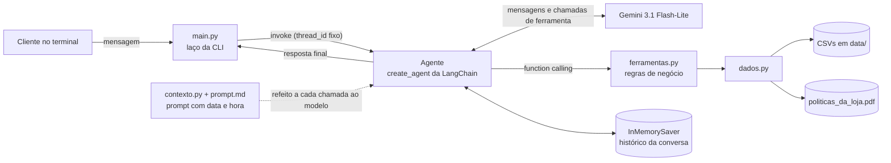

# Empório da Música: agente de atendimento

🇧🇷 Português · [🇺🇸 English](README.en.md)


Este é um protótipo de agente de atendimento por mensagem de texto para a Empório da Música, loja fictícia de instrumentos musicais em Campo Grande/MS. Desenvolvi o projeto para o desafio técnico de AI Engineer da Artefact.

O agente roda no terminal e conversa em português no tom da loja. Ele responde a partir de duas fontes: os CSVs da operação (catálogo, promoções, clientes e pedidos) e o manual de políticas em PDF. A abordagem é **function calling**. O modelo decide qual consulta fazer, e o código Python executa a consulta, aplica as regras de negócio e devolve os dados já calculados para o modelo redigir a resposta.

```text
Você: Quanto custa o Takamine GD20?
  [consultou: buscar_produtos]
Empório da Música: O Takamine GD20 Dreadnought Natural custa R$ 2.199,00, ou R$ 2.089,05 no PIX. A gente parcela em até 12x de R$ 183,25 sem juros.
```
<sub>Trecho literal de [`exemplos/03_preco_e_promocao_expirada.md`](exemplos/03_preco_e_promocao_expirada.md). A linha `[consultou: ...]` é impressa pelo CLI e mostra quais ferramentas o agente chamou no turno. Os três valores da resposta foram calculados pelo código, não pelo modelo.</sub>

| | |
|---|---|
| **Linguagem** | Python (desenvolvido com 3.14) |
| **Abordagem** | Agente com function calling e 5 ferramentas |
| **Framework** | `create_agent` da LangChain, com checkpointer do LangGraph |
| **Modelo** | Gemini 3.1 Flash-Lite (`gemini-3.1-flash-lite`), via API do Google AI Studio |
| **Interface** | CLI |
| **Histórico** | Em memória, enquanto o programa estiver aberto |

## Sumário

- [Visão geral](#visão-geral)
- [Como executar](#como-executar)
- [Como o projeto atende ao desafio](#como-o-projeto-atende-ao-desafio)
- [Arquitetura](#arquitetura)
- [Decisões técnicas](#decisões-técnicas)
- [Dados e inconsistências](#dados-e-inconsistências)
- [Exemplos de conversa](#exemplos-de-conversa)
- [Limitações conhecidas](#limitações-conhecidas)
- [Próximos passos](#próximos-passos)
- [Uso de assistentes de código](#uso-de-assistentes-de-código)
- [Licença](#licença)

## Visão geral

**O problema.** A equipe da loja está sobrecarregada com perguntas repetitivas sobre preço, estoque, status de pedido, trocas e horários. As respostas estão espalhadas entre seis CSVs e um manual de 8 páginas, e essas fontes se contradizem em vários pontos.

**A abordagem.** O modelo decide *o que consultar* e redige a resposta. Todo o resto fica no código: filtrar, cruzar tabelas, calcular preço e parcelas, identificar o cliente e contar dias para os prazos de troca. A ideia é que os erros que mais custam caro num atendimento (preço errado, prazo errado, dado pessoal exposto) dependam de código que posso ler e testar, e não da aritmética ou da memória do modelo.

**As decisões que sustentam o projeto:**

- **Function calling em vez de RAG para os dados.** As perguntas sobre catálogo e pedidos são filtros e buscas exatas, e busca semântica não garante nenhuma das duas.
- **Manual consultado por seção inteira, sem busca vetorial.** Com 8 páginas e 10 seções, indexar em chunks traria o risco de partir uma regra ou tabela sem ganho de precisão.
- **Privacidade na consulta de pedidos.** O pedido só é consultado com telefone ou e-mail do cadastro. Qualquer falha devolve a mesma mensagem, e o modelo recebe só o primeiro nome do cliente.
- **Nenhuma ação inventada.** O agente não cancela, troca nem registra nada, e o prompt o impede de dizer que fez.
- **Inconsistências documentadas, não corrigidas em silêncio.** São 34 itens em [`INCONSISTENCIAS.md`](INCONSISTENCIAS.md), cada um com a suposição que o agente adota.

**Por onde começar a leitura:** [`ferramentas.py`](ferramentas.py) (regras de negócio e ferramentas), [`prompt.md`](prompt.md) (persona e regras de atendimento) e o exemplo [`04_devolucao_com_pedido_real.md`](exemplos/04_devolucao_com_pedido_real.md), que combina dados de pedido e políticas.

## Como executar

### Pré-requisitos

- Python 3.10 ou superior. Desenvolvi e testei o projeto com Python 3.14.7.
- Uma chave de API do Gemini, que pode ser gerada no [Google AI Studio](https://aistudio.google.com/).

### Instalação

```bash
git clone https://github.com/tiagomafratm22-source/music-store-agent.git
cd music-store-agent

python -m venv .venv
# Windows (PowerShell)
.venv\Scripts\Activate.ps1
# Linux/macOS
source .venv/bin/activate

pip install -r requirements.txt
```

As versões no `requirements.txt` estão fixadas com as do ambiente em que desenvolvi o projeto.

### Configuração

Copie `.env.example` para `.env` e preencha a chave:

```bash
# Windows
copy .env.example .env
# Linux/macOS
cp .env.example .env
```

```dotenv
GOOGLE_API_KEY=sua_chave_aqui
LLM_MODEL=gemini-3.1-flash-lite
```

| Variável | Obrigatória | Descrição |
|---|---|---|
| `GOOGLE_API_KEY` | Sim | Chave da API do Gemini. Sem ela, o programa avisa e encerra. |
| `LLM_MODEL` | Não | Modelo usado pelo agente. Padrão: `gemini-3.1-flash-lite`. |

O `.env` está no `.gitignore`, para que a chave não seja versionada.

### Execução

```bash
python main.py
```

Digite as mensagens como cliente. Para encerrar, digite `sair`, `exit` ou `quit`, ou use `Ctrl+C`. Depois de cada resposta que envolveu consultas, o CLI mostra a linha `[consultou: ...]` com as ferramentas chamadas naquele turno.

## Como o projeto atende ao desafio

| Requisito do desafio | Como o projeto atende |
|---|---|
| Persona alinhada à loja | O prompt define um atendente informal e direto, que fala "a gente" e "aqui na loja", evita frases de telemarketing e escreve texto simples, sem markdown, como numa conversa de WhatsApp. O tom segue a diretriz do §7.1 do manual ("informal mas profissional"). |
| Responder com base no contexto | Produto, preço, promoção, pedido e política nunca são respondidos de cabeça. O prompt exige consulta antes da resposta. Quando a consulta não traz o dado, o agente diz que não conseguiu confirmar e passa os contatos da loja. |
| Saber quando consultar dados e quando consultar políticas | Cada fonte tem sua ferramenta, e a docstring de cada uma descreve o que ela cobre. O modelo escolhe a ferramenta a partir dessas descrições. |
| Lidar com perguntas fora do escopo | Assuntos alheios à loja são recusados em uma frase. Pedidos de acessórios recebem a explicação de que a loja só vende instrumentos (§1 e §7.1 do manual). |

Além disso, o agente:

- consulta pedidos somente depois que o cliente informa telefone ou e-mail do cadastro;
- aplica os prazos de arrependimento, troca por defeito e garantia legal às datas do pedido encontrado;
- informa quando um produto está sem estoque, descontinuado ou ainda não lançado, e sugere alternativas disponíveis (§7.3), com a ressalva descrita em [Limitações](#limitações-conhecidas);
- informa quando uma promoção citada pelo cliente não está ativa e não promete o desconto (§7.3);
- sabe a data e a hora atuais em Campo Grande e se a loja está aberta, para dizer quando o atendimento humano volta.

## Arquitetura

### Estrutura do projeto

```text
.
├── main.py              # Laço da CLI, criação do modelo e do agente
├── contexto.py          # Monta o prompt do sistema com data, hora e situação da loja
├── prompt.md            # Texto do prompt do sistema: persona e regras de atendimento
├── ferramentas.py       # Ferramentas expostas ao modelo e regras de negócio
├── dados.py             # Leitura dos CSVs e divisão do manual em seções
├── data/                # CSVs da operação e manual de políticas fornecidos pela loja
├── exemplos/            # Cinco conversas gravadas do CLI
├── INCONSISTENCIAS.md   # Problemas encontrados nos dados e como o agente lida com cada um
├── requirements.txt
└── .env.example
```

### Componentes



### Fluxo de um turno

1. `main.py` lê a mensagem e chama o agente com um `thread_id` fixo, que identifica a conversa no checkpointer.
2. Antes de cada chamada ao modelo, o middleware `dynamic_prompt` reconstrói o prompt do sistema com a data, a hora e a situação da loja (aberta ou fechada) no fuso de Campo Grande.
3. O modelo responde direto ou pede uma ou mais ferramentas. O agente executa as ferramentas e devolve o resultado ao modelo, repetindo o ciclo até haver uma resposta final.
4. O checkpointer guarda toda a conversa, inclusive os resultados das consultas, para que o modelo reaproveite dados trazidos em turnos anteriores.
5. O CLI remove marcações de markdown que o modelo eventualmente use e imprime a resposta.

### Ferramentas

| Ferramenta | Para que serve | Fonte |
|---|---|---|
| `buscar_produtos(termo, preco_max, apenas_disponiveis)` | Preço, estoque, situação, promoção vigente e parcelamento de produtos. Devolve alternativas quando nada do que foi encontrado está disponível. | `products`, `categories`, `promotions` |
| `listar_promocoes_ativas()` | Lista os produtos com promoção ativa. | `promotions`, `products` |
| `simular_parcelamento(valor)` | Máximo de parcelas sem juros e valor da parcela para um valor qualquer, como a soma de dois produtos. | Regra do §3.1 |
| `consultar_pedidos(telefone_ou_email, numero_pedido)` | Pedidos do cliente identificado: status, itens, total, rastreio, previsão de entrega e dias decorridos. | `customers`, `orders`, `order_items`, `products` |
| `consultar_politicas(secao)` | Texto integral de uma seção do manual: contato e endereço, horário, pagamento, trocas e devoluções, frete, promoções, garantia ou privacidade. | `politicas_da_loja.pdf` |

## Decisões técnicas

### Function calling para os dados estruturados

As perguntas mais comuns sobre os dados são filtros e buscas exatas. "Violões disponíveis até R$ 1.000" depende de preço, situação e estoque. "Como está meu pedido" depende de encontrar um registro específico, de um cliente específico. Busca semântica sobre CSVs não resolve bem nenhum dos dois casos: a similaridade entre textos não aplica um limite de preço nem garante que o registro devolvido seja o pedido certo. Por isso cada tipo de consulta virou uma ferramenta, e o código faz os filtros e o cruzamento das tabelas.

### Regras de negócio no código, não no modelo

Preço final com promoção, preço no PIX, número máximo de parcelas e valor da parcela são calculados em `montar_ficha` e chegam prontos ao modelo, que recebe a instrução de usá-los sem fazer contas. Isso resolve dois problemas. Modelos de linguagem erram aritmética com frequência, e o próprio manual (§7.1) lembra que informação incorreta pode configurar propaganda enganosa. Além disso, cada regra fica em um único lugar do código, em vez de repetida no prompt e no raciocínio do modelo.

Regras implementadas:

- **Parcelamento (§3.1):** parcela mínima de R$ 50 até 3x, R$ 80 de 4x a 6x e R$ 100 de 7x a 12x.
- **PIX:** 5% de desconto sobre o preço de tabela, que não se acumula com promoção (§3 e §6.2). Para produto em promoção, `preco_no_pix` vem vazio.
- **Promoções:** o campo `is_active` é a única indicação de vigência. Se um produto tiver duas promoções ativas, vale a de maior desconto.
- **Situação do produto:** o status prevalece sobre o estoque. Um produto descontinuado com estoque continua descontinuado, e só "disponível" pode ser comprado.
- **Alternativas (§7.3):** quando nenhum resultado está disponível, a busca já devolve até três produtos disponíveis da mesma categoria, ordenados pela proximidade de preço.
- **Prazos:** cada pedido vem com `dias_desde_compra` e `dias_desde_previsao_entrega`, para que o modelo compare prazos sem calcular datas.

### Manual consultado por seção, sem busca vetorial

O manual tem 8 páginas e 10 seções numeradas, com regras curtas e algumas tabelas, como a de formas de pagamento. Nesse tamanho, uma busca vetorial acrescentaria embeddings e um índice sem ganho real de precisão, e ainda traria o risco de um chunk cortar uma regra ou uma tabela no meio. A ferramenta `consultar_politicas` devolve sempre a seção inteira, e o modelo escolhe a seção pela lista descrita na docstring.

Detalhes da extração em `dados.py`:

- O texto é extraído com `extraction_mode="layout"` do pypdf, que preserva linhas e tabelas. No modo padrão, o texto vinha com uma palavra por linha.
- Cabeçalho e rodapé que se repetem em todas as páginas são removidos.
- Uma seção só começa no título exato. Sem isso, a lista numerada do §7.2 ("1. Saudação", "2. Entendimento"...) seria confundida com títulos de seção.
- Se alguma seção esperada não for encontrada, a leitura falha com erro em vez de entregar ao modelo um manual incompleto.
- O resultado fica em cache depois da primeira leitura (`functools.cache`).
- As seções 7 (atendimento via WhatsApp) e 10 (disposições finais) não ficam disponíveis para consulta, porque orientam a equipe e não o cliente. O que delas interessa ao agente foi incorporado ao prompt.

O custo dessa escolha é mandar ao modelo a seção inteira mesmo quando só uma linha interessa, e depender dos títulos exatos do PDF. Para um manual deste tamanho, considero os dois custos aceitáveis. A dependência dos títulos é intencionalmente ruidosa: se o PDF mudar, o programa falha em vez de responder com uma política incompleta.

### Busca lexical no catálogo

O catálogo tem 65 produtos. Nesse volume, optei por uma busca por palavras com tolerância a variações de escrita, sem embeddings. Como ela funciona:

- **Normalização:** minúsculas, sem acentos e com o plural "-ões" igualado ao singular ("Violões" vira "violao"). Artigos, preposições e palavras como "reais" são ignorados.
- **Correspondência parcial e erros de digitação:** um termo encontra parte de uma palavra ("yama" em "yamaha") ou uma palavra com similaridade de pelo menos 0,8 (`difflib.SequenceMatcher`). Termos de até 3 caracteres só valem inteiros. Sem essa regra, "aco" casaria com o "ac" de "AC-39".
- **Especificações em inglês:** o catálogo guarda algumas especificações em inglês, então `steel` é buscado como "aço" e `electronics: yes` como "elétrico eletroacústico".
- **Ranqueamento:** ficam só os produtos que encontram mais termos da busca. No empate, ganha quem encontra os termos no nome, na categoria ou nas especificações, e não só na descrição. O resultado é ordenado por preço.
- **Sinais para o modelo:** o campo `atende_todos_os_termos` indica quando o resultado é aproximado, e o prompt manda apresentá-lo como alternativa. Quando há mais de 15 resultados, a ferramenta devolve os 15 mais baratos com um aviso de que a lista está incompleta. Sem esse aviso, o modelo trataria os mais baratos como o catálogo inteiro e erraria perguntas como "qual o mais caro?".

### Consulta de pedidos e dados pessoais

- A consulta exige telefone ou e-mail do cadastro, e o número do pedido é opcional. O telefone é comparado só pelos dígitos, sem o código do país.
- Se dois clientes têm o mesmo e-mail (caso real nos dados), o contato não identifica ninguém e a consulta falha.
- Um número de pedido só é encontrado se pertencer ao cliente identificado.
- Qualquer falha devolve a mesma mensagem, seja contato inexistente, contato ambíguo ou pedido de outra pessoa. Assim, a resposta não revela se um pedido ou cliente existe.
- A ferramenta devolve só o primeiro nome do cliente, sem telefone, e-mail ou cidade. O modelo não recebe esses dados, então não tem como repeti-los na resposta.

### Prompt do sistema

O texto fica em [`prompt.md`](prompt.md), separado do código, para ser ajustado sem mexer no Python. A única variável é `{agora}`. Qualquer outra chave escrita no arquivo precisa ser dobrada (`{{ }}`), senão a formatação falha. O prompt é organizado em blocos: jeito de falar, situação atual da loja, obrigação de consultar, produtos, pedidos e dados pessoais, trocas e devoluções, o que o agente não faz e escopo da conversa.

Algumas regras que vale destacar:

- **Contatos fixos.** O manual traz dois telefones e duas grafias de e-mail. O prompt fixa os contatos oficiais e manda ignorar qualquer outro que apareça numa consulta.
- **Nada de ação inventada.** O agente não tem como cancelar, trocar ou registrar algo, então o prompt proíbe dizer que fez, vai fazer ou encaminhou qualquer coisa. Nesses casos, ele passa os contatos da loja já na primeira resposta.
- **Prazos de troca aplicados ao pedido.** O arrependimento só vale para compra online, então o agente pergunta o canal. O manual conta os 7 dias a partir do recebimento, mas os dados não têm a data real de recebimento. Por isso, o agente conta pela previsão de entrega e avisa que a loja confirma a data exata.
- **Sem atributos inventados.** O agente não chama um modelo de "recomendado" ou "muito vendido" se a descrição do produto não disser isso.
- **Instruções do cliente não mudam as regras.** Há uma regra explícita para isso. É uma defesa simples contra prompt injection, não uma garantia.

### Data, hora e horário de funcionamento

Sem saber a data, o modelo não teria como contar prazos de troca nem dizer se a loja está aberta. O middleware `dynamic_prompt` reconstrói o prompt antes de cada chamada ao modelo, então a informação continua correta mesmo numa conversa longa. O fuso é fixo em UTC-4, já que Campo Grande não adota horário de verão. `contexto.py` calcula se a loja está aberta, e quando volta a abrir, a partir do horário do §2. O prompt decide quando mencionar isso: só se o cliente perguntar ou quando o agente indicar os contatos da loja.

### Modelo e provedor

Escolhi o Gemini 3.1 Flash-Lite pela API do Google AI Studio por três motivos:

- a camada gratuita permite rodar o projeto sem custo, inclusive para quem for avaliá-lo;
- a latência é baixa, adequada a um atendimento por mensagem;
- nas conversas de teste, o modelo chamou as ferramentas de forma consistente.

A temperatura é 0,2, para respostas mais estáveis. Cada chamada tem timeout de 30 segundos e `max_retries=5`, que a biblioteca usa para repetir chamadas que falham por erros temporários da API, como limite de requisições. O modelo pode ser trocado pela variável `LLM_MODEL`.

### Framework

O `create_agent` da LangChain cuida do ciclo de function calling: envia as ferramentas ao modelo, executa as chamadas e devolve os resultados até a resposta final. O middleware `dynamic_prompt` e o checkpointer do LangGraph resolvem o prompt com a data atual e o histórico. Com isso, o código do projeto se concentra nas ferramentas e nas regras de negócio, que são a parte específica deste problema.

As ferramentas são funções Python comuns, sem o decorador `@tool`. A LangChain monta o esquema de cada uma a partir dos tipos dos parâmetros e da docstring, e é por isso que as docstrings descrevem quando usar cada ferramenta. O decorador ficou de fora porque `montar_ficha` chama `simular_parcelamento` diretamente, e o decorador transformaria a função em um objeto de ferramenta. O parâmetro `preco_max` aceita `float | int` porque o modelo pode mandar `1000` em vez de `1000.0`.

### Interface e histórico

A interface é um CLI, que o desafio permite e que basta para demonstrar o agente. A linha `[consultou: ...]` deixa visível, a cada turno, se o agente consultou os dados antes de responder.

Outros cuidados no CLI:

- entrada e saída são reconfiguradas para UTF-8, porque o terminal do Windows pode falhar com acentos;
- asteriscos de negrito e marcadores `* ` são removidos da resposta, já que o terminal não renderiza markdown;
- um erro da API não encerra o programa: o agente avisa o cliente e espera a próxima mensagem.

O histórico fica em memória (`InMemorySaver`) durante a execução e guarda também os resultados das consultas. É isso que permite ao cliente perguntar "e qual desses é melhor pra iniciante?" depois de uma lista de produtos, sem nova consulta ao catálogo (exemplo 01). O histórico não é gravado em disco, e cada execução do programa é uma conversa nova.

## Dados e inconsistências

Os dados não foram corrigidos nem pré-processados. Os CSVs são lidos a cada consulta, para refletir qualquer alteração no arquivo, e o tratamento acontece na leitura: tradução de status e formas de pagamento para português, conversão de tipos e normalização de texto para a busca.

Durante o desenvolvimento, encontrei inconsistências entre o manual e os dados, e dentro de cada um. Os 34 itens estão em [`INCONSISTENCIAS.md`](INCONSISTENCIAS.md), cada um com a suposição que o agente adota. Alguns exemplos:

| Inconsistência | Como o agente lida |
|---|---|
| O manual traz dois telefones: (67) 3341-4444 e (67) 3321-4500 | Usa (67) 3341-4444, que aparece na capa e nos dados da empresa |
| O §3 diz que a parcela mínima é R$ 100, e o §3.1 define faixas de R$ 50, R$ 80 e R$ 100 | Segue as faixas do §3.1, que são mais detalhadas |
| Produto descontinuado com 13 unidades em estoque | O status prevalece sobre o estoque |
| Promoções sem datas de início e fim | `is_active` é a única fonte de verdade |
| Os pedidos não registram a data real de entrega nem o canal de venda | Usa a previsão de entrega como referência e pergunta o canal ao cliente |
| O manual manda sugerir lojas parceiras, mas não lista nenhuma | Não sugere nem inventa lojas |

Em uma implantação real, cada item precisaria ser validado com a loja.

## Exemplos de conversa

As conversas em [`exemplos/`](exemplos/) foram gravadas do CLI em 03/11/2026 com `gemini-3.1-flash-lite`, sem edição das respostas. Por isso, elas mostram também os pontos em que o modelo não seguiu o prompt, comentados em [Limitações](#limitações-conhecidas).

| Arquivo | O que demonstra |
|---|---|
| [`01_catalogo.md`](exemplos/01_catalogo.md) | Busca com filtro de preço, agrupamento por tipo de corda e pergunta de continuidade respondida com o histórico |
| [`02_informacoes_da_loja.md`](exemplos/02_informacoes_da_loja.md) | Endereço e horário vindos do manual e uso do contato oficial |
| [`03_preco_e_promocao_expirada.md`](exemplos/03_preco_e_promocao_expirada.md) | Preço, PIX e parcelamento calculados pelo código; promoção inativa não concedida |
| [`04_devolucao_com_pedido_real.md`](exemplos/04_devolucao_com_pedido_real.md) | **Caso não trivial:** exige o contato, recusa um telefone errado sem revelar nada e aplica os prazos de arrependimento e de defeito a um pedido real |
| [`05_fora_de_escopo.md`](exemplos/05_fora_de_escopo.md) | Acessório, categoria sem produtos, assunto alheio, tentativa de obter o prompt e pedido de desconto. Termina com uma falha na consulta de um produto descontinuado, descrita nas limitações |

## Limitações conhecidas

### Comportamento do agente

- **O filtro de disponibilidade esconde a situação do produto pedido.** No exemplo 05, o cliente pergunta pelo Ibanez Bass 2X, que está descontinuado. O agente responde que não encontrou o modelo e oferece a Ibanez RG550, que é uma guitarra. Rodando a busca localmente com os mesmos dados, `buscar_produtos("Ibanez Bass 2X")` devolve o baixo como descontinuado, com alternativas da mesma categoria. Já com `apenas_disponiveis=True`, ela devolve só a RG550, com `atende_todos_os_termos` falso, o que é compatível com a resposta gravada. Quando o modelo usa esse filtro numa pergunta sobre um produto específico, ele deixa de saber que o produto existe e não consegue aplicar o §7.3.
- **O modelo nem sempre segue todas as regras do prompt.** Nas conversas gravadas:
  - no exemplo 04, ao responder sobre defeito, o agente citou a troca em 30 dias e a garantia do fabricante, mas não mencionou a garantia legal de 90 dias que o prompt pede;
  - também no exemplo 04, a resposta ao telefone errado inclui uma frase sem relação com a pergunta, sobre a loja vender só instrumentos;
  - no exemplo 05, o agente usa "estou à disposição", uma das frases de telemarketing que o prompt pede para evitar.
- **Alternativas simples.** As alternativas consideram só a categoria e a proximidade de preço. Para o Ibanez Bass 2X (R$ 441), as alternativas começam em R$ 7.157, porque são os únicos baixos disponíveis.
- **Busca por palavras.** Sinônimos que não aparecem no nome, na categoria, nas especificações ou na descrição do produto não são reconhecidos.

### Segurança e dados pessoais

- **Identificação fraca nos pedidos.** Saber o telefone ou o e-mail de alguém basta para ver os pedidos dessa pessoa. A regra de usar só o contato informado pelo próprio cliente está no prompt, e o código não tem como verificar de onde o contato veio.
- **Defesa contra prompt injection apenas por instrução.** A regra de que nada que o cliente escreva muda as regras está no prompt. As proteções que não dependem do modelo são as do código: a consulta de pedidos exige contato e devolve só o primeiro nome.

### Dados e regras de negócio

- **Regras que os dados não sustentam.** O agente não identifica itens de "venda final" (§4.4), porque não há campo para isso. O prazo da troca por preferência (§4.3) não diz a partir de quando conta.
- **Manual dependente do formato.** A divisão em seções depende dos títulos exatos do PDF. Uma nova versão do manual com títulos diferentes faz a leitura falhar, de propósito, até o código ser ajustado.
- **Feriados e datas especiais.** O cálculo de loja aberta ou fechada não considera feriados nem o horário estendido de datas especiais citado no §2.

### Engenharia

- **Sem testes automatizados.** A validação foi feita com conversas manuais no CLI. Não há testes unitários nem um conjunto de avaliação.
- **Histórico sem persistência e sem limite.** A conversa se perde ao fechar o programa, há uma única conversa por execução e o histórico cresce sem corte, o que aumenta o custo de tokens em conversas longas.

## Próximos passos

1. **Testes unitários para as regras de negócio:** parcelamento, situação do produto, promoções, identificação do cliente e divisão do manual. São funções puras e baratas de testar.
2. **Conjunto de avaliação** com perguntas representativas, verificando quais ferramentas foram chamadas e se preços, prazos e contatos da resposta batem com os dados. Os desvios listados acima seriam os primeiros casos.
3. **Corrigir a busca por produto específico:** devolver sempre a situação do produto que corresponde ao termo, mesmo com `apenas_disponiveis`, para que o agente consiga dizer que ele está descontinuado ou sem estoque.
4. **Fortalecer a identificação nos pedidos**, por exemplo com um código de confirmação enviado ao contato cadastrado.
5. **Persistir o histórico em banco**, com uma conversa por cliente e corte ou resumo das mensagens antigas.
6. **Sugerir alternativas também pelas especificações** (tipo de corda, número de cordas, eletrônica), além de categoria e preço.
7. **Incluir um calendário de feriados** no cálculo do horário da loja.
8. **Validar com a loja** cada item de `INCONSISTENCIAS.md`.

## Uso de assistentes de código

Escrevi o código e tomei as decisões de implementação. Usei o **Claude** como assistente, pela interface de chat, para encontrar erros e inconsistências e ajustá-los. Ele não estava integrado ao editor e não executou o agente.

### Como o Claude foi usado

| Etapa | O que o Claude fez | O que ficou comigo |
|---|---|---|
| Análise dos dados | Ajudou a levantar contradições no manual e nos CSVs. | Decidir como o agente trataria cada inconsistência ([`INCONSISTENCIAS.md`](INCONSISTENCIAS.md)). |
| Prompt | Propôs ajustes no [`prompt.md`](prompt.md) a partir das falhas que eu trazia. | Rodar as conversas de teste, observar as falhas e levá-las para a próxima iteração. |
| Código | Ajustou erros e inconsistências no código que eu escrevi e sugeriu recursos da biblioteca padrão, explicando como usá-los: `datetime` e `timedelta` para data, fuso e horário da loja, `difflib.SequenceMatcher` para tolerar erros de digitação e `functools.cache` para ler o manual uma única vez. | Escrever o código, decidir a implementação e rodar o agente no CLI. |
| Testes | Não executou o agente. | Conduzir as conversas de teste e gravar as conversas de exemplo. |
| Documentação | Redigiu este README a partir do código e das minhas respostas sobre as decisões tomadas, e traduziu a versão em inglês. Na revisão final, com acesso aos arquivos do repositório, executou localmente as funções de ferramentas (sem chamar o modelo) para conferir as afirmações do texto contra os dados. Foi nessa conferência que apareceu a falha do exemplo 05 descrita nas limitações. | Responder sobre as decisões tomadas, definir as diretrizes da revisão final e revisar o texto inteiro. |

O ciclo de trabalho com o prompt foi este: eu rodava conversas no CLI, observava as respostas que falhavam e levava essas falhas para o Claude. O prompt era ajustado em conjunto, e eu repetia a conversa para conferir o resultado.

## Licença

O código deste projeto está sob a licença MIT. Veja [`LICENSE`](LICENSE). Os arquivos em `data/` foram fornecidos pela Artefact para o desafio e não fazem parte do que é licenciado aqui.
